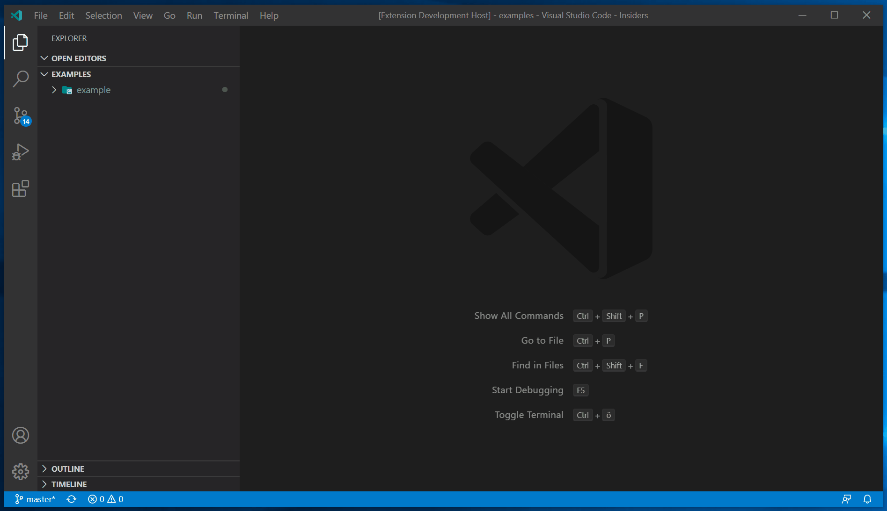
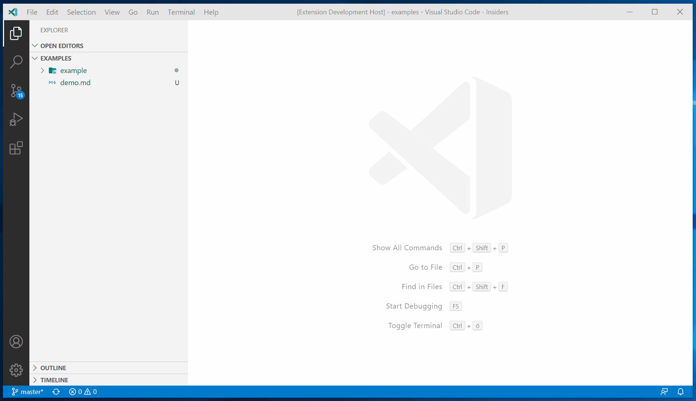
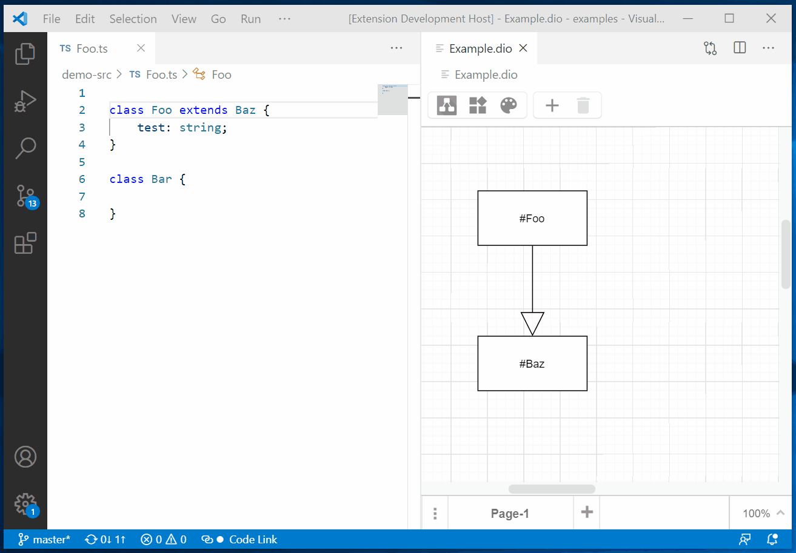
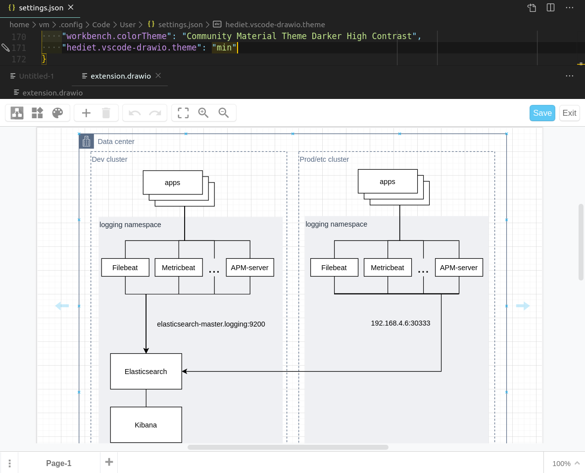

# DrawSlidesCode: a fork of the Draw.io VS Code Integration that edits and builds slide decks drawn in draw.io

This fork of [hediet/vscode-drawio](https://github.com/hediet/vscode-drawio), by Henning Dieterichs, edits slide decks drawn in draw.io and builds them into one HTML file and a PDF.
A deck is a folder of draw.io files, one per section, whose slides are draw.io XML that version control tracks and an agent can edit.
The HTML file presents the slides in a browser with their links, videos and interactive pages, and the PDF holds the same slides.
The fork installs beside the original, because every command, editor, setting and context key carries the prefix `drawSlidesCode.` and the extension is `yujunhuang.drawslidescode`.
The README of the original follows the sections of the fork, and its commands and settings read `drawSlidesCode.<name>` here in place of `hediet.vscode-drawio.<name>`.
The editor `hediet.vscode-drawio-text` of the original is `drawSlidesCode.textEditor` here, and the commands of the original show under the category `DrawSlidesCode` in place of `Draw.io`.

DrawSlidesCode is made by Yujun Huang and is not made or endorsed by draw.io Ltd. draw.io is a registered trademark of draw.io Ltd.

The guide for authors of slides, [docs/presentations.md](./docs/presentations.md), says how to start a deck and how the build numbers the slides.
The guide also says how a formula, a color, a style of the deck, a link, a video and an embedded page work, and what each warning of the build means.

| folder or file | what it holds |
|---|---|
| `src/deck/` | the build of a deck, which imports no `vscode`, so that the commands of the extension and the command line `dist/cli.js` run it alike |
| `deck-templates/` | what a new deck starts from: the slide template, the starting palette of the colors, the color configurations of the editor and the launcher, and the page of the HTML file |
| `drawio-custom-plugins/slides/` | the plugins of the editor of a deck, which the build shares |
| `docs/presentations.md` | the guide for authors of slides |
| `skills/` | the skills of an agent that starts a deck, `deck-skeleton`, builds its HTML file, `deck-html`, or builds its PDF, `deck-pdf`, which the installed extension holds as well |
| `GOALS.md` | the principles of building the slides and of their content, which a fork may change to steer an agent that changes the fork |

## The fork loads the plugins of the slides without asking

The setting `drawSlidesCode.slides`, `false` by default and `true` in the `.vscode/settings.json` of a deck, loads the plugins in `drawio-custom-plugins/slides/` into the editor of every drawing it covers, without asking.
The plugins play the videos and show the pages of the cells, style the lists of the template and check the language with LanguageTool on this machine.
They also draw the pictures named relative to the deck, and keep the page view and the saved files as the build expects.
Their headers say what each one does.
The fork tells them the folder of the deck, the nearest folder above the drawing that holds a `package.json`.
The page of the editor gives the text of a label its font color, where the original gives it the color of the interface.
The editor also opens `*.drawio.xml`, the files of the decks.

Seven settings of scope `resource` describe a deck, so that the `.vscode/settings.json` of each deck holds its own:

| setting | what it gives |
|---|---|
| `drawSlidesCode.colors` | the colors of the deck, each a name of letters and digits, such as `accent`, with a value `#RRGGBB`, which the formulas of every page may name, as in `\textcolor{accent}{x}`, and which the color picker names and offers as presets |
| `drawSlidesCode.deckStyles` | the styles of the deck by kind of geometry, such as `wire`, `rectangle` or `ellipse`, each a name of letters and digits with a style string of draw.io, which the section Deck styles of the Format panel gives, saves and updates |
| `drawSlidesCode.listStyles` | the indent, the marker and the color and the size of the marker of each level of a bulleted and of a numbered list, and the gap between the items |
| `drawSlidesCode.listMarkers` | the markers of the menu List style |
| `drawSlidesCode.templates` | the multi-page template files of the deck, `${deckFolder}/templates/*.drawio.xml` by default, whose pages the submenu Insert slide of the menus Insert and Pages inserts |
| `drawSlidesCode.slideSize` | the size of a slide, 1920 by 1080 by default, which the page view keeps at one page |
| `drawSlidesCode.languageTool` | the address of the LanguageTool server that checks the label being edited, `http://localhost:8081` by default |

`${deckFolder}` in a path stands for the folder of the deck, and a relative path is read from that folder.
A color of a level of `drawSlidesCode.listStyles` and a `fill`, `stroke`, `font` or `gradient` of `drawSlidesCode.customColorSchemes`, the swatches of the Style tab of the Format panel, may be the name of a color of `drawSlidesCode.colors`.
The output channel Drawio Integration Log names each color that the extension leaves out and each name of a color that `drawSlidesCode.colors` does not define.
VS Code shows a swatch before each value of `drawSlidesCode.colors` in `settings.json`, and its color picker edits the value.
After a new value there, while a drawing of the deck is open, a message asks whether to write it into the shapes, the lines and the texts linked to the color in the drawing files of the deck.

The section Deck colors of the Format panel lists the colors of `drawSlidesCode.colors` in the editor of a drawing, each with its swatch and its name.
It sits in the Style tab, after the swatches and before Fill, in the Style tab of the diagram while nothing is selected, where it edits the list alone, and in the tab Text while a label is edited.
A click on a swatch gives each selected shape the color by its kind: a text shape takes it as font color, an edge and a shape whose fill draw.io does not draw as line color, and any other shape as fill color.
A selected group gives the color to the shapes in it.
The buttons Fill, Line and Font of the row give the selected shapes the color as fill, line or font color alone.
A click on a swatch, on Fill, on Line or on Font sets the style keys of the color options of draw.io, in one step of the undo history.
While a label of formatted text is edited, a click on a swatch or on Font gives the selected text the color, as the option Font Color of draw.io does.
While a label of plain text is edited, the click gives the whole label the color.
With an empty selection, a click on a swatch leaves the drawing as it is.
The tooltip of a swatch says what a click on it does for the selection at hand.
A shape takes the value `#RRGGBB` of the color and a link to the name of the color beside the value.
The editor and the build draw a linked shape in the current value of the color, as the guide says.
The button ✎ opens the color dialog of draw.io, which gives the color a new value, and a new name in the text field renames the color.
The button × removes a color after a dialog of VS Code that counts the uses that keep its last value.
Add color adds a color, named `color1` or the next free number, with the value that the color dialog gives.
The extension writes each change into `drawSlidesCode.colors` of the `.vscode/settings.json` of the workspace folder of the drawing, as an edit of that setting alone, so the comments of the file stay.
When the file is missing, or holds no `drawSlidesCode.colors` while another settings file defines it, VS Code writes the colors of the folder with the change into the `.vscode/settings.json` of the workspace folder.
A color that the user settings or the file of a workspace of several folders define can be recolored there, and the extension refuses to rename or remove it.
A rename also renames the color where `drawSlidesCode.listStyles` and `drawSlidesCode.customColorSchemes` of the file name it.
A new value from the section also goes into the shapes, the lines and the texts linked to the color in the section files, the templates and the open drawings of the deck.
A new name or a removal also goes into the links and the formulas that name the color.
A drawing file with unsaved changes takes the change in its editor and stays unsaved.
The extension refuses a name that another color has, a name of other characters than letters and digits starting with a letter, and a value other than `#RRGGBB`.
The extension also refuses a change while the settings file has unsaved changes.
A message in VS Code then gives the reason, and the section shows the colors as they were.

The section Deck styles of the Format panel follows the section Deck colors in the Style tab.
It lists the styles of `drawSlidesCode.deckStyles` of the kinds of the selected cells, as the Format sidebar of Keynote lists the styles of the kind of object selected.
The kind of an edge is wire, and the kind of a vertex is the shape that draw.io draws for it, such as rectangle or ellipse.
Each style is a tile with a preview, its name under it and the buttons ✎ and × under the name, in one grid per kind.
A click on a preview gives the style to the selected cells of its kind in one step of the undo history, and New style from selection saves the style of one selected cell under a new name.
When a selected cell differs from its style, the button Update redefines the style from the cell and writes the change into every cell of the deck linked to the style, and Revert gives the cell the style again.
✎ renames the style in the rename dialog of draw.io, and × removes it after a dialog of VS Code that counts the linked cells.
A cell linked to a style holds `deckStyle=<name>` beside every key of the style, so a draw.io without the extension draws it the same.
A style holds keys of appearance alone, so a wire stays attached where it was and its label stays in place.
A cell keeps the keys in which it differs from its style through an update, and the guide says which keys an update writes.
A new deck starts with the styles of text that the cells of the template link to, `talkTitle`, `slideTitle`, `bulletText` and `slideNumber`, so a slide inserted from the template takes the styles of its deck.

The editor follows a change of `drawSlidesCode.colors`, `drawSlidesCode.deckStyles`, `drawSlidesCode.listStyles`, `drawSlidesCode.listMarkers`, `drawSlidesCode.customColorSchemes`, `drawSlidesCode.presetColors` and `drawSlidesCode.colorNames` without a reload, so the zoom and the undo history stay.
After a new name or a removal of a color, the editor starts a new undo history.
The formulas, the presets and the names of the color picker, the swatches, the colors of the list markers and the menu List style take the new settings, and a list made after the change takes the new list style.
A color taken out of `drawSlidesCode.colors` stays defined for the formulas until the editor reloads.
The editor also follows a save of a template file, whose pages the submenu Insert slide then offers.

## The commands and the command line build a deck into an HTML file and a PDF

The build of `src/deck/` exports each page of a deck to SVG with the draw.io viewer that the extension bundles, so the slides it draws match the editor.
It then writes the HTML file, which shows the SVGs with the links, the videos and the embedded pages of the cells, and prints the SVGs into the PDF.
The commands of the category DrawSlidesCode, the command line `dist/cli.js` and the launcher `drawslidescode.cjs` of each deck are in the section The scripts of package.json and the commands of VS Code build the presentation of [docs/presentations.md](./docs/presentations.md).
The section of the same guide on what the build needs names the command Install Chromium for the Build, and the section on the colors of a formula names the commands Import Colors from TeX and Export Colors to TeX.

The build drives a headless browser through `playwright-core`, the first that starts of the Chromium of Playwright, Google Chrome, Microsoft Edge and the programs `chromium`, `chromium-browser`, `google-chrome` and `google-chrome-stable` of the PATH.
The user setting `drawSlidesCode.browserPath` names another browser by the path of its program, and a build that finds no browser offers to install Chromium or to set the path.
The extension needs VS Code 1.90 or later, whose Node.js 20 `playwright-core` needs.
`dist/cli.js` runs the same build without VS Code, with Node.js 22 or later, so that an agent, a script or a CI job builds a deck.

## The command Set Up a Presentation in This Folder starts a deck or sets up the editor for one

The command *DrawSlidesCode: Set Up a Presentation in This Folder*, in the command palette and in the context menu of a folder in the Explorer, sets up the folder clicked in the Explorer, or else the workspace folder, and asks which one when the workspace has several.
The command runs only in a trusted workspace, and needs `git` on the path of VS Code to start a presentation.

The command chooses what to do by what the folder holds:

| the folder holds | the command |
|---|---|
| no presentation and none of the files of a new one | asks for the title, the name of the folder by default, and starts a presentation as a git repository of its own, as the mode `init` of the command line does |
| a presentation, as its section files ending in `.drawio.xml` or its multi-page file, without `.vscode/settings.json` | writes the settings and copies the template that the presentation lacks, as the mode `vscode` does |
| a presentation with `.vscode/settings.json` | says that the folder is set up, and says how to load the plugins when the file does not set `drawSlidesCode.slides` to `true` |
| no presentation, and a `package.json`, a `.vscode/settings.json` or another file that `init` refuses to replace | names those files, suggests a new folder for the presentation, and writes nothing |

Before the command writes, a dialog lists the files that it writes.
The output channel Drawio Integration Log shows what the command wrote, and a message gives the reason when the command stops.
After the start, a message says that the command Build the Presentation and `npm run build` in the folder build the deck.
VS Code reads the `.vscode/settings.json` of a workspace folder alone, so the editor opens the first section file only when the folder is a workspace folder, and the message otherwise offers to open the folder in a new window.

A presentation that the Python build of the draw.io presentation framework started runs `build-slides.py` of the framework in the scripts of its `package.json`.
On such a presentation, the command also offers to move it to the launcher, in a dialog that lists the changes.
The move copies `drawslidescode.cjs` into the folder and rewrites each such script to `node drawslidescode.cjs <mode>`, and keeps `config` and every other key of `package.json`.
The mode `migrate` of the command line makes the same move.

## Build the extension and install it

The build needs Node.js 22 or later, as `engines` of `package.json` says, yarn 1 and the submodule `drawio`.
The continuous integration builds and tests on Node.js 22 and 24.
On Node.js 22.23.4 and 24.21.0, `yarn install --frozen-lockfile`, `yarn build` and `yarn test` pass both with and without `NODE_OPTIONS=--no-experimental-strip-types`, which the original names for Node.js 23, so the commands below leave the flag out.
On Node.js 26.13.0, the install, `yarn build-extension`, `yarn build-plugins`, `yarn test` and `dist/cli.js` pass, and `yarn build` stops in `vsce package`, because the package `buffer-equal-constant-time` 1.0.1 that `@vscode/vsce` 3.2.1 loads reads `buffer.SlowBuffer`, which Node.js 26 lacks.

The commands build, test and install the extension:

```sh
git submodule update --init --depth 1 drawio
yarn install --frozen-lockfile
yarn build    # dist/extension.vsix and dist/cli.js
yarn test
code --install-extension dist/extension.vsix --force
```

Reload the window of VS Code after an installation, with *Developer: Reload Window*.
A clone serves the command line after its build, through `DRAWSLIDESCODE_EXTENSION=<clone>` or `node <clone>/dist/cli.js`.

## Publish the extension on the Visual Studio Marketplace and on Open VSX

The Visual Studio Marketplace serves VS Code, and Open VSX serves VSCodium and the other builds of the open source code of VS Code.
Both take the `dist/extension.vsix` of the build above.
Build it from a commit that GitHub holds, because the page of the extension shows the pictures of this README from the default branch on GitHub.
`yarn build` packages a release, as `"preRelease": false` in `package.json` says, and `yarn package-extension-preRelease` packages a pre-release.
Each registry takes a version number once, so a release raises `version` in `package.json` and adds its section to `CHANGELOG.md`.

The workflow `.github/workflows/publish.yml` publishes each push to `main`, such as the merge of a pull request, to both registries, through trusted publishing, with no token stored in the repository.
A feature branch that raises `version` therefore publishes that version when it is merged, and a merge that keeps the version publishes nothing, because the workflow skips a version that a registry already holds.
The workflow runs in the GitHub environment `release`, whose deployment branches are `main` alone, so a run from another branch gets no token.
Each registry holds a trusted publisher for the repository `HuangYujun-JunkyTalent/draw-slides-code`, the workflow `publish.yml` and the environment `release`.
The Marketplace holds it under Trusted Publishing on the publisher management page below, and Open VSX on its page [Trusted publishers](https://open-vsx.org/user-settings/trusted-publishers).
The upload and the commands below publish by hand, such as the first version on a registry.

The publisher `yujunhuang` of the Marketplace is created once, with a Microsoft account, on the [publisher management page](https://marketplace.visualstudio.com/manage).
The same page uploads the first version with New extension and then Visual Studio Code, and each later version with Update in the menu of the extension.
The upload needs no personal access token of Azure DevOps, whose global tokens retire on December 1, 2026, as the [guide to publishing extensions](https://code.visualstudio.com/api/working-with-extensions/publishing-extension) of VS Code says.

Open VSX publishes after an Eclipse account with the GitHub user name of the login to open-vsx.org, the Publisher Agreement signed on the profile page of open-vsx.org, and an access token, as its [guide to publishing extensions](https://github.com/eclipse/openvsx/wiki/Publishing-Extensions) says.
The commands run the latest version of `ovsx` through `npx`, since `package.json` holds no `ovsx`:

```sh
npx ovsx@latest create-namespace yujunhuang -p <token>    # once
npx ovsx@latest publish dist/extension.vsix -p <token>
```

The namespace lets everyone publish in it until its owner claims it, as the page [Namespace Access](https://github.com/eclipse/openvsx/wiki/Namespace-Access) of the same wiki says.

## The README of the original

### Draw.io VS Code Integration

This unofficial extension integrates [Draw.io](https://app.diagrams.net/) (also known as [diagrams.net](https://www.diagrams.net/)) into VS Code.  
Mentioned in the official diagrams.net [blog](https://www.diagrams.net/blog/embed-diagrams-vscode).

### Features

-   Edit `.drawio`, `.dio`, `.drawio.svg` or `.drawio.png` files in the Draw.io editor.
    -   To create a new diagram, simply create an empty `*.drawio`, `*.drawio.svg` or `*.drawio.png` file and open it.
    -   `.drawio.svg` are valid `.svg` files that can be embedded in Github readme files! No export needed.
    -   `.drawio.png` are valid `.png` files! No export needed. You should use `.svg` though whenever possible - they look much better!
    -   To convert between different formats, use the `Draw.io: Convert To...` command.
-   `.drawio` files are plain XML: they diff cleanly in git, and AI assistants can read, edit and review diagram changes like any other code.
-   Uses an offline version of Draw.io by default.
-   Multiple Draw.io themes are available.
-   Use Liveshare to collaboratively edit a diagram with others.
-   Nodes/edges can be linked with code spans.

### Demo




### Editing .drawio.svg/.drawio.png Files

You can directly edit and save `.drawio.svg` and `.drawio.png` files.
These files are perfectly valid svg/png-images that contain an embedded Draw.io diagram.
Whenever you edit such a file, the svg/png part of that file is kept up to date.

The logo of the original extension, `docs/logo.drawio.png`, is such a `.drawio.png` file that has been created with the extension itself!



If you want readable diffs, for your reviewers and your AI tools alike, prefer `.drawio` over `.drawio.png` diagrams.

### Collaboratively Edit Or Present Diagrams

With version 1.0 of this extension, extensive support for [VS Code Liveshare](https://visualstudio.microsoft.com/de/services/live-share/) has been added. You can now edit or present your Draw.io diagrams remotely, while seeing each participant's cursor and selection! This can be used for discussing, reviewing or brainstorming diagrams.
With Draw.io's freehand drawing tool and integrated LaTeX support, this extension becomes an advanced whiteboard solution that can be used for remote code interviews!


_Internally, this extension synchronizes Draw.io diagrams with text documents.
These text documents are shared by Liveshare. As Liveshare has no understanding of the text, modification conflicts might occur on simultaneous modifications._

### Code Link Feature

In the status bar, you can enable or disable the code link feature.
If it is enabled and you double click on a node whose label starts with `#`,
you will perform a workspace search for a symbol matching the rest of the label.

If you have a node labeled `#MyClass` and a class of name `MyClass`, you will jump to its source if you double click the node!

**Please note that you have to open at least one file of the project that contains the symbol.**
Otherwise, VS Code will not consider this project when searching for symbols.
This file itself does not have to contain the symbol though.

Thanks to my latest github sponsors, this feature is open source and freely available now.

_TIP_: If you open the draw.io editor to the right side (i.e. the second editor column) and navigate to a symbol,
the diagram will stay visible.



### Themes

<details>
    <summary><b>Available Draw.io Themes</b></summary>
    <!-- Please use HTML syntax here so that it works for Github and mkdocs -->
    <ul>
        <li><p>Theme "atlas"</p></li>
        <li><p>Theme "Kennedy"</p></li>
        <li><p>Theme "min"</p>
        <li><p>Theme "dark"</p></li>
    </ul>
</details>

### Associate `.svg` Files With The Draw.io Editor

By default, this extension only handles `*.drawio.svg` files.
Add this to your VS Code `settings.json` file if you want to associate it with `.svg` files:

```json
"workbench.editorAssociations": {
    "*.svg": "drawSlidesCode.textEditor",
}
```

You won't be able to edit arbitrary SVG files though - only those that have been created with Draw.io or this extension!

### Light and Dark `.drawio.svg` Files

By default, `.drawio.svg` files are saved with light colors, whatever theme the editor uses.
Set `drawSlidesCode.svgAppearance` to `auto` to make them adapt to the color scheme of the page that shows them, for example a README on GitHub in dark mode, or to `dark` to always save them with dark colors.
The setting applies the next time a diagram is saved. Add it to the workspace settings so that everyone on a team saves the same file.

### Inline Diagrams in VS Code's Markdown Editor (Experimental, Insiders only)

VS Code Insiders ships an experimental WYSIWYG Markdown editor (`View: Reopen Editor With... > Markdown Editor`).
In that editor, every fenced code block tagged `drawio` is replaced by a live, resizable Draw.io editor:

````markdown
```drawio
<mxfile>...</mxfile>
```
````

Edits are written straight back into the fenced block, so the Markdown file stays the single source of truth and undo/redo, dirty state and hot exit keep working.
The block attributes of the inline editor are honored: `locked` makes a block read-only and `height=N` fixes its height, e.g. ```` ```drawio locked height=300 ````.
The Markdown editor's own lock toggle also puts the diagrams into read-only mode.

Notes:

-   VS Code's contribution point for this is experimental and only exists in Insiders builds; in stable VS Code (and in the regular Markdown preview) the fence is shown as text or rendered by the preview plugin as before.
-   Dynamic providers only run in trusted workspaces.
-   Settings that are baked into the editor (theme, appearance, custom libraries, fonts, ...) apply the next time the Markdown editor is opened.
-   Draw.io plugins are not loaded into the inline editors.

### Editing the Diagram and its XML Side by Side

You can open the same `*.drawio` file with the Draw.io editor and as xml file.
They are synchronized, so you can switch between them as you like it.
This is super practical if you want to use find/replace to rename text or other features of VS Code to speed up your diagram creation/edit process.
Use the `View: Reopen Editor With...` command to toggle between the text or the Draw.io editor. You can open multiple editors for the same file.
This does not make much sense for SVG files though, as the draw.io diagram is stored in its metadata.

The same goes for AI assistants: the file is a visual diagram for you and plain text for your agent.
When an agent edits the XML, the change shows up in the open diagram right away, and in a pull request it can read the diff of a diagram (an added node, a changed connection, a new label) and act on it just like it would on code.


### Exporting Diagrams From Other Extensions

Other extensions, keybindings and automations can export a diagram file to SVG, PNG or `.drawio` without opening it and without prompts:

```ts
const uri = await vscode.commands.executeCommand("drawSlidesCode.export", {
	source: "diagrams/architecture.drawio",
	destination: "public/diagrams/architecture.svg", // optional
	format: "svg", // optional: "svg", "png" or "drawio"
	overwrite: true, // optional, defaults to false
});
```

-   `source` and `destination` are a `Uri`, a URI string, an absolute path or a path relative to the first workspace folder. Missing folders are created.
-   Without `destination`, the export is written next to the source (`architecture.drawio` → `architecture.svg`). Without `format`, it is taken from the extension of `destination`, else SVG.
-   The saved file is exported, with the first page for multi-page diagrams. It is briefly rendered in a temporary editor tab that closes again.
-   The command resolves to the `Uri` of the written file and rejects with the reason if the export fails, e.g. because the destination exists and `overwrite` is not set.

Without arguments, the command is `DrawSlidesCode: Export To...`, which asks for the format and file of the diagram in the active editor.

### Contributors

-   Henning Dieterichs, [hediet](https://github.com/hediet) on Github (Main Contributor / Author)
-   Vincent Rouillé, [Speedy37](https://github.com/Speedy37) on Github

### See Also / Similar Extensions

-   [Draw.io](https://app.diagrams.net/) - This extension relies on the giant work of Draw.io. Their embedding feature enables this extension! This extension bundles a recent version of Draw.io.
-   [vscode-drawio](https://github.com/eightHundreds/vscode-drawio) by eightHundreds.

## License

The extension is under the GNU General Public License, version 3, as the original hediet.vscode-drawio is, in [LICENSE.md](./LICENSE.md).
The original is copyright Henning Dieterichs and its contributors, and the changes of the fork, which `CHANGELOG.md` and the git history of this repository name, are copyright 2026 Yujun Huang.
The additional permission in [LICENSE-EXCEPTION.md](./LICENSE-EXCEPTION.md) frees every file that the extension writes or copies for a presentation, so the author of a presentation may keep it closed, sell it and give it under terms of the author's choice.
The submodule `drawio`, the draw.io web application of JGraph, is under the Apache License, version 2.0, in `drawio/LICENSE`.
A contribution comes under the same license and the same permission, as [CONTRIBUTING.md](./CONTRIBUTING.md) says.
The build writes the licenses and the notices of the packages that the files of `dist/` bundle into `dist/THIRD-PARTY-NOTICES.md`, which the vsix holds.
