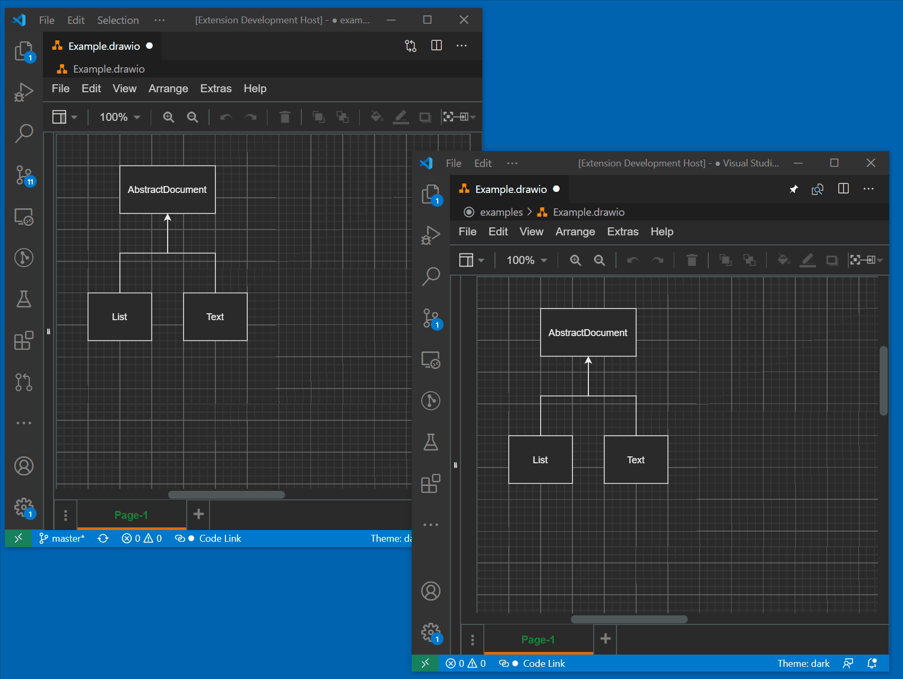
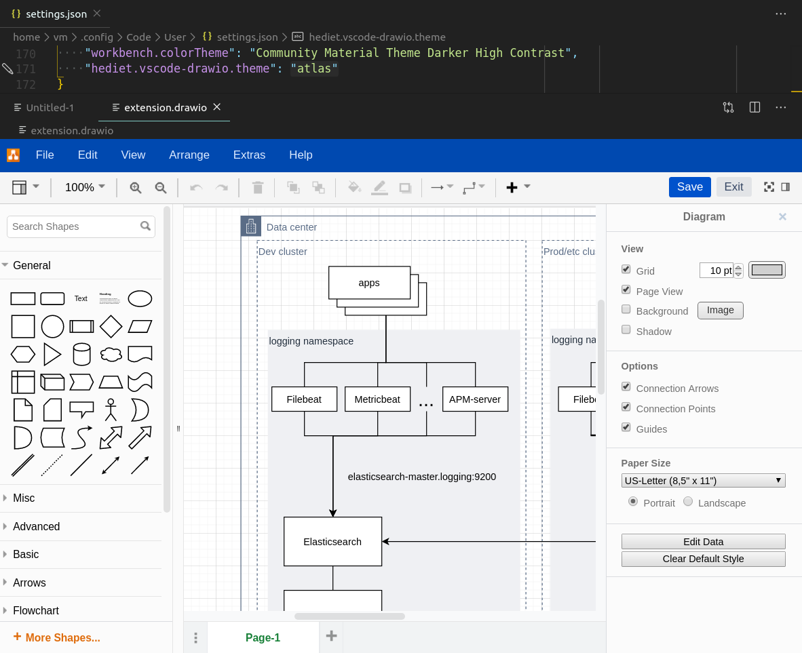
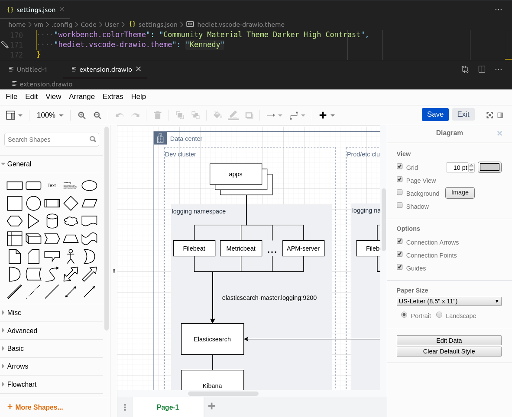
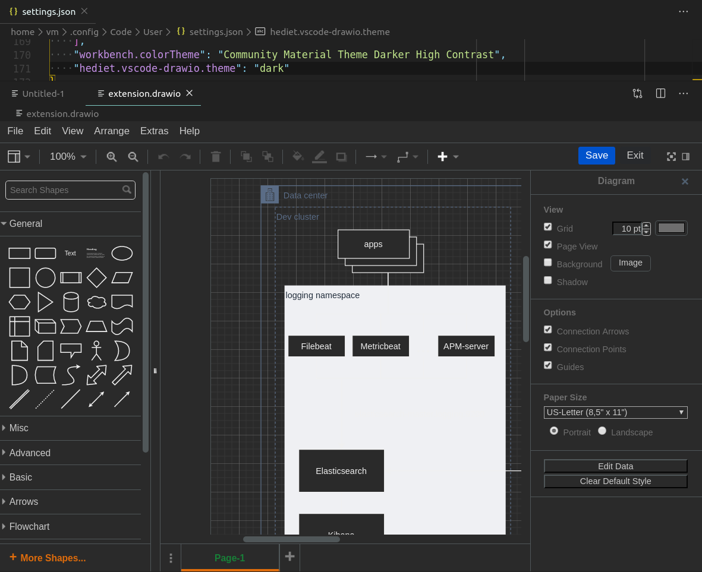
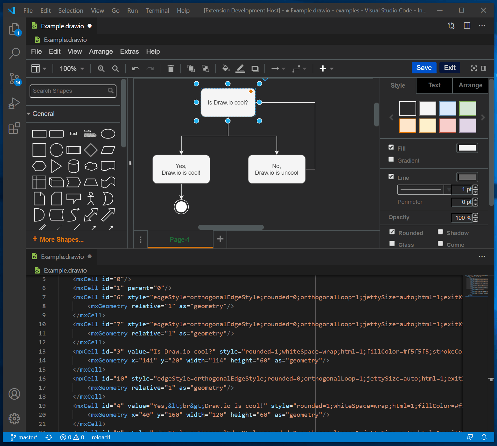

# Draw.io Slides: a fork of the Draw.io VS Code Integration for decks of the draw.io presentation framework

This fork of [hediet/vscode-drawio](https://github.com/hediet/vscode-drawio), by Henning Dieterichs, is the editor of the decks of the draw.io presentation framework.
It installs beside the original, because every command, editor, setting and context key carries the prefix `drawioSlides.` and the extension is `yujunhuang.drawio-slides`.
The rest of this README is the README of the original, whose settings read `drawioSlides.<name>` here in place of `hediet.vscode-drawio.<name>`.

## The fork loads the plugins of the framework without asking

The setting `drawioSlides.slides`, `false` by default and `true` in the `.vscode/settings.json` of a deck, loads the plugins in `drawio-custom-plugins/slides/` into the editor of every drawing it covers, without asking.
The plugins play the videos and show the pages of the cells, style the lists of the template and check the language with LanguageTool on this machine.
They also draw the pictures named relative to the deck, and keep the page view and the saved files as the build of the framework expects.
Their headers say what each one does.
The fork tells them the folder of the deck, the nearest folder above the drawing that holds a `package.json`.
The page of the editor gives the text of a label its font colour, where the original gives it the colour of the interface.
The editor also opens `*.drawio.xml`, the files of the decks.

The build of the framework reads the draw.io viewer and three of the plugins from the newest installed version of this extension, so that the slides it draws match the editor.

## Build the extension and install it

The build needs yarn 1 and the submodule `drawio`.
The continuous integration of the original builds with Node.js 22, and Node.js 23 needs `NODE_OPTIONS=--no-experimental-strip-types`, as the commands below set it:

```sh
git submodule update --init --depth 1 drawio
yarn install --frozen-lockfile
NODE_OPTIONS=--no-experimental-strip-types yarn build    # dist/extension.vsix
code --install-extension dist/extension.vsix --force
```

Reload the window of VS Code after an installation, with *Developer: Reload Window*.

## The README of the original

### Draw.io VS Code Integration

[](https://twitter.com/intent/follow?screen_name=hediet_dev)

This unofficial extension integrates [Draw.io](https://app.diagrams.net/) (also known as [diagrams.net](https://www.diagrams.net/)) into VS Code.  
Mentioned in the official diagrams.net [blog](https://www.diagrams.net/blog/embed-diagrams-vscode).

### Features

-   Edit `.drawio`, `.dio`, `.drawio.svg` or `.drawio.png` files in the Draw.io editor.
    -   To create a new diagram, simply create an empty `*.drawio`, `*.drawio.svg` or `*.drawio.png` file and open it.
    -   `.drawio.svg` are valid `.svg` files that can be embedded in Github readme files! No export needed.
    -   `.drawio.png` are valid `.png` files! No export needed. You should use `.svg` though whenever possible - they look much better!
    -   To convert between different formats, use the `Draw.io: Convert To...` command.
-   `.drawio` files are plain XML: they diff cleanly in git, and AI assistants can read, edit and review diagram changes like any other code.
-   Uses an offline version of Draw.io by default.
-   Multiple Draw.io themes are available.
-   Use Liveshare to collaboratively edit a diagram with others.
-   Nodes/edges can be linked with code spans.

### Demo


### Editing .drawio.svg/.drawio.png Files

You can directly edit and save `.drawio.svg` and `.drawio.png` files.
These files are perfectly valid svg/png-images that contain an embedded Draw.io diagram.
Whenever you edit such a file, the svg/png part of that file is kept up to date.

The logo of this extension is such a `.drawio.png` file that has been created with the extension itself!


If you want readable diffs, for your reviewers and your AI tools alike, prefer `.drawio` over `.drawio.png` diagrams.

### Collaboratively Edit Or Present Diagrams

With version 1.0 of this extension, extensive support for [VS Code Liveshare](https://visualstudio.microsoft.com/de/services/live-share/) has been added. You can now edit or present your Draw.io diagrams remotely, while seeing each participant's cursor and selection! This can be used for discussing, reviewing or brainstorming diagrams.
With Draw.io's freehand drawing tool and integrated LaTeX support, this extension becomes an advanced whiteboard solution that can be used for remote code interviews!



_Internally, this extension synchronizes Draw.io diagrams with text documents.
These text documents are shared by Liveshare. As Liveshare has no understanding of the text, modification conflicts might occur on simultaneous modifications._

### Code Link Feature

In the status bar, you can enable or disable the code link feature.
If it is enabled and you double click on a node whose label starts with `#`,
you will perform a workspace search for a symbol matching the rest of the label.

If you have a node labeled `#MyClass` and a class of name `MyClass`, you will jump to its source if you double click the node!

**Please note that you have to open at least one file of the project that contains the symbol.**
Otherwise, VS Code will not consider this project when searching for symbols.
This file itself does not have to contain the symbol though.

Thanks to my latest github sponsors, this feature is open source and freely available now.

_TIP_: If you open the draw.io editor to the right side (i.e. the second editor column) and navigate to a symbol,
the diagram will stay visible.


### Themes

<details>
    <summary><b>Available Draw.io Themes</b></summary>
    <!-- Please use HTML syntax here so that it works for Github and mkdocs -->
    <ul>
        <li><p>Theme "atlas"</p></li>
        <li><p>Theme "Kennedy"</p></li>
        <li><p>Theme "min"</p>
        <li><p>Theme "dark"</p></li>
    </ul>
</details>

### Associate `.svg` Files With The Draw.io Editor

By default, this extension only handles `*.drawio.svg` files.
Add this to your VS Code `settings.json` file if you want to associate it with `.svg` files:

```json
"workbench.editorAssociations": {
    "*.svg": "hediet.vscode-drawio-text",
}
```

You won't be able to edit arbitrary SVG files though - only those that have been created with Draw.io or this extension!

### Light and Dark `.drawio.svg` Files

By default, `.drawio.svg` files are saved with light colors, whatever theme the editor uses.
Set `hediet.vscode-drawio.svgAppearance` to `auto` to make them adapt to the color scheme of the page that shows them, for example a README on GitHub in dark mode, or to `dark` to always save them with dark colors.
The setting applies the next time a diagram is saved. Add it to the workspace settings so that everyone on a team saves the same file.

### Inline Diagrams in VS Code's Markdown Editor (Experimental, Insiders only)

VS Code Insiders ships an experimental WYSIWYG Markdown editor (`View: Reopen Editor With... > Markdown Editor`).
In that editor, every fenced code block tagged `drawio` is replaced by a live, resizable Draw.io editor:

````markdown
```drawio
<mxfile>...</mxfile>
```
````

Edits are written straight back into the fenced block, so the Markdown file stays the single source of truth and undo/redo, dirty state and hot exit keep working.
The block attributes of the inline editor are honored: `locked` makes a block read-only and `height=N` fixes its height, e.g. ```` ```drawio locked height=300 ````.
The Markdown editor's own lock toggle also puts the diagrams into read-only mode.

Notes:

-   VS Code's contribution point for this is experimental and only exists in Insiders builds; in stable VS Code (and in the regular Markdown preview) the fence is shown as text or rendered by the preview plugin as before.
-   Dynamic providers only run in trusted workspaces.
-   Settings that are baked into the editor (theme, appearance, custom libraries, fonts, ...) apply the next time the Markdown editor is opened.
-   Draw.io plugins are not loaded into the inline editors.

### Editing the Diagram and its XML Side by Side

You can open the same `*.drawio` file with the Draw.io editor and as xml file.
They are synchronized, so you can switch between them as you like it.
This is super practical if you want to use find/replace to rename text or other features of VS Code to speed up your diagram creation/edit process.
Use the `View: Reopen Editor With...` command to toggle between the text or the Draw.io editor. You can open multiple editors for the same file.
This does not make much sense for SVG files though, as the draw.io diagram is stored in its metadata.

The same goes for AI assistants: the file is a visual diagram for you and plain text for your agent.
When an agent edits the XML, the change shows up in the open diagram right away, and in a pull request it can read the diff of a diagram (an added node, a changed connection, a new label) and act on it just like it would on code.



### Exporting Diagrams From Other Extensions

Other extensions, keybindings and automations can export a diagram file to SVG, PNG or `.drawio` without opening it and without prompts:

```ts
const uri = await vscode.commands.executeCommand("hediet.vscode-drawio.export", {
	source: "diagrams/architecture.drawio",
	destination: "public/diagrams/architecture.svg", // optional
	format: "svg", // optional: "svg", "png" or "drawio"
	overwrite: true, // optional, defaults to false
});
```

-   `source` and `destination` are a `Uri`, a URI string, an absolute path or a path relative to the first workspace folder. Missing folders are created.
-   Without `destination`, the export is written next to the source (`architecture.drawio` → `architecture.svg`). Without `format`, it is taken from the extension of `destination`, else SVG.
-   The saved file is exported, with the first page for multi-page diagrams. It is briefly rendered in a temporary editor tab that closes again.
-   The command resolves to the `Uri` of the written file and rejects with the reason if the export fails, e.g. because the destination exists and `overwrite` is not set.

Without arguments, the command is `Draw.io: Export To...`, which asks for the format and file of the diagram in the active editor.

### Contributors

-   Henning Dieterichs, [hediet](https://github.com/hediet) on Github (Main Contributor / Author)
-   Vincent Rouillé, [Speedy37](https://github.com/Speedy37) on Github

### See Also / Similar Extensions

-   [Draw.io](https://app.diagrams.net/) - This extension relies on the giant work of Draw.io. Their embedding feature enables this extension! This extension bundles a recent version of Draw.io.
-   [vscode-drawio](https://github.com/eightHundreds/vscode-drawio) by eightHundreds.
